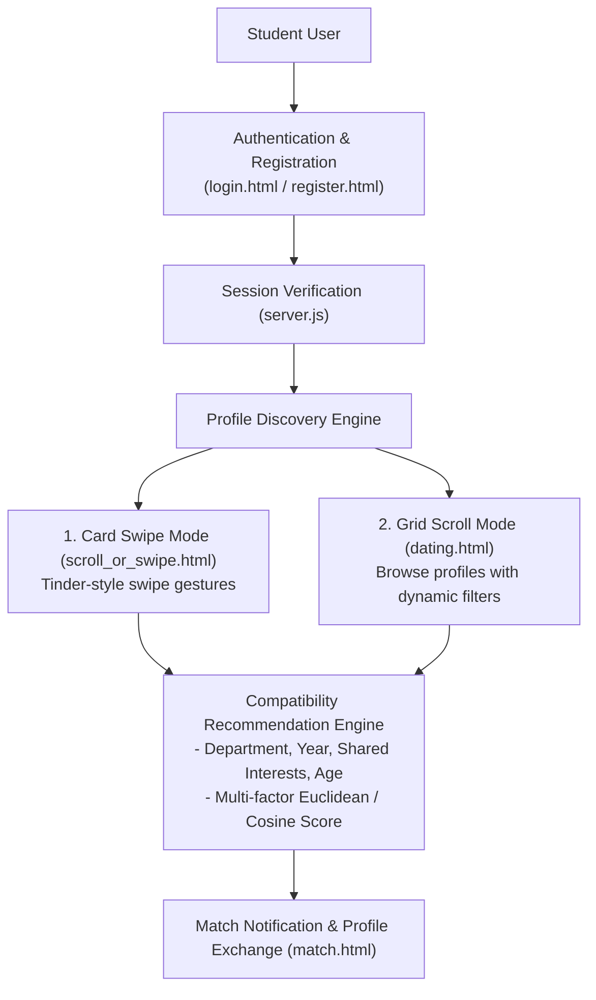

# Campus Dating & Matchmaking Web Platform

[-yellow.svg)](https://developer.mozilla.org/)
[](https://nodejs.org/)
[]()
[](https://www.cse.iitb.ac.in/)

> **Academic Affiliation**: Course Project for **CS 108: Software Systems Lab (SSL)**, IIT Bombay  
> **Author**: **Dheeraj Kumar Maradana** ([@dheerajkumar2005](https://github.com/dheerajkumar2005))

---

## 📌 Executive Summary

This repository contains a full-stack campus dating and matchmaking web application developed from scratch as part of the Software Systems Lab at IIT Bombay. 

The platform connects university students through profile discovery, dynamic interest-based filtering, and a multi-factor compatibility recommendation algorithm, providing an interactive, mobile-responsive user experience with both card-swiping and infinite scroll layouts.

---

## 🏗️ Architecture & Matching Flow



---

## 🔬 Core Features & Modules

* **User Authentication & Profiles (`login.html`, `register.html`, `forgot.html`)**:
  * Form validation, password recovery, and secure local session handling.
* **Dual Interaction Modes**:
  * **Swipe Interface (`scroll_or_swipe.html`)**: Interactive JavaScript gestures simulating mobile-style swipe cards.
  * **Browse & Filter Interface (`dating.html`)**: Real-time attribute filtering by department, age, hobbies, and year of study.
* **Compatibility Scoring (`script.js`, `server.js`)**:
  * Ranks student profiles based on overlapping interests and user-specified preference weights.
* **Lightweight Node.js Backend (`server.js`)**:
  * REST API routing for profile retrieval, filter queries, and registration persistence.

---

## 📁 Repository Structure

```
├── server.js                   # Node.js backend server handling HTTP endpoints and auth
├── script.js                   # Client-side UI interactions, card swipe physics, and filter logic
├── dating.html / match.html    # Profile feed and matching screens
├── login.html / register.html  # Authentication interfaces
├── scroll_or_swipe.html        # Interactive card-swipe discovery view
├── style.css                   # Global responsive styling and animations
├── students.json               # Seed student profiles and metadata
└── report.pdf                  # Complete project design and testing report
```

---

## 🚀 Getting Started

### 1. Prerequisites
* [Node.js](https://nodejs.org/) (`>= 16.x`)
* npm

### 2. Installation & Launch
```bash
# Clone the repository
git clone https://github.com/dheerajkumar2005/Campus-Dating-Web-App.git
cd Campus-Dating-Web-App

# Install dependencies
npm install

# Start the web server
node server.js
```

Open `http://localhost:3000` (or the configured port in `server.js`) in your browser to launch the web platform.
